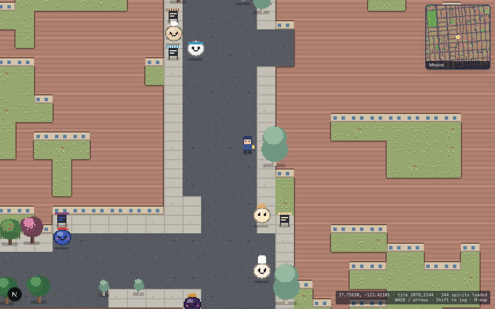
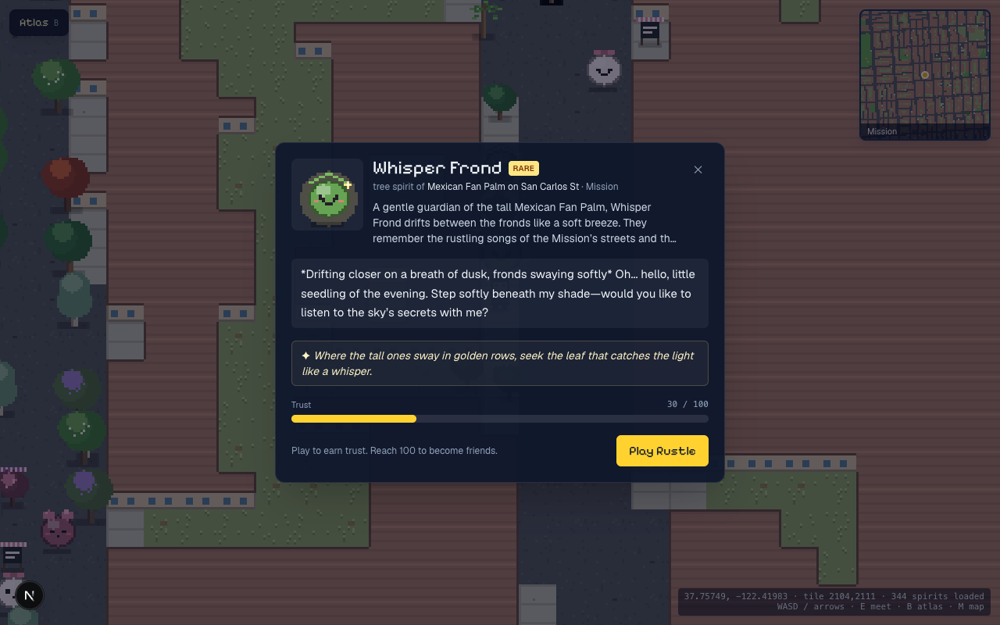
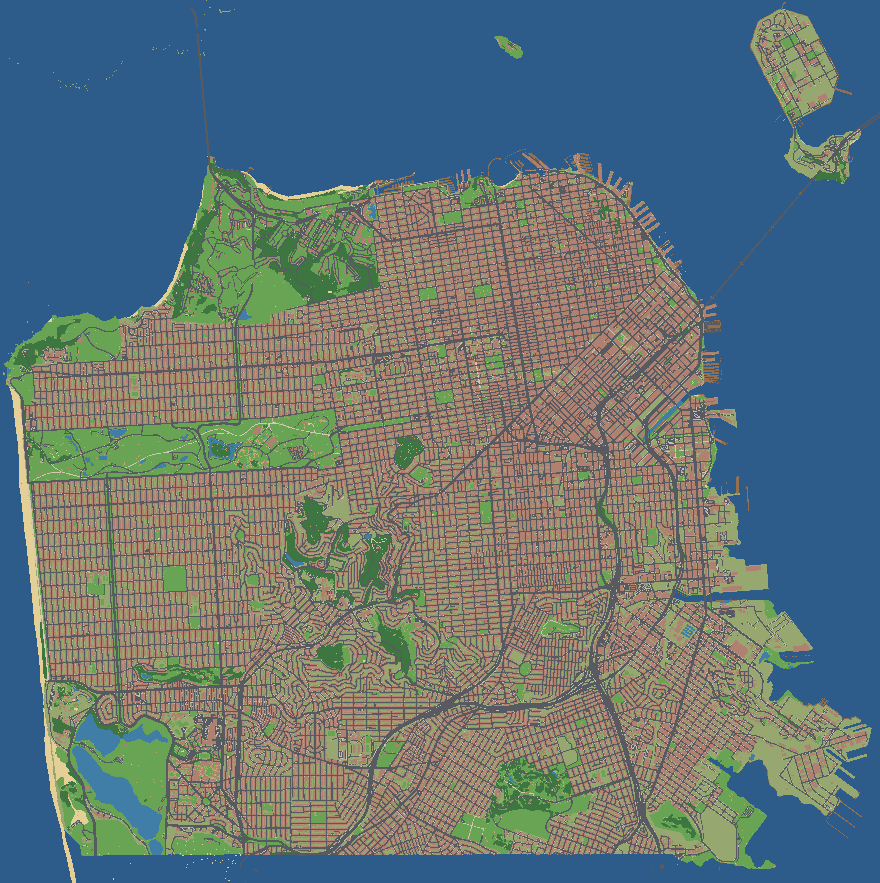
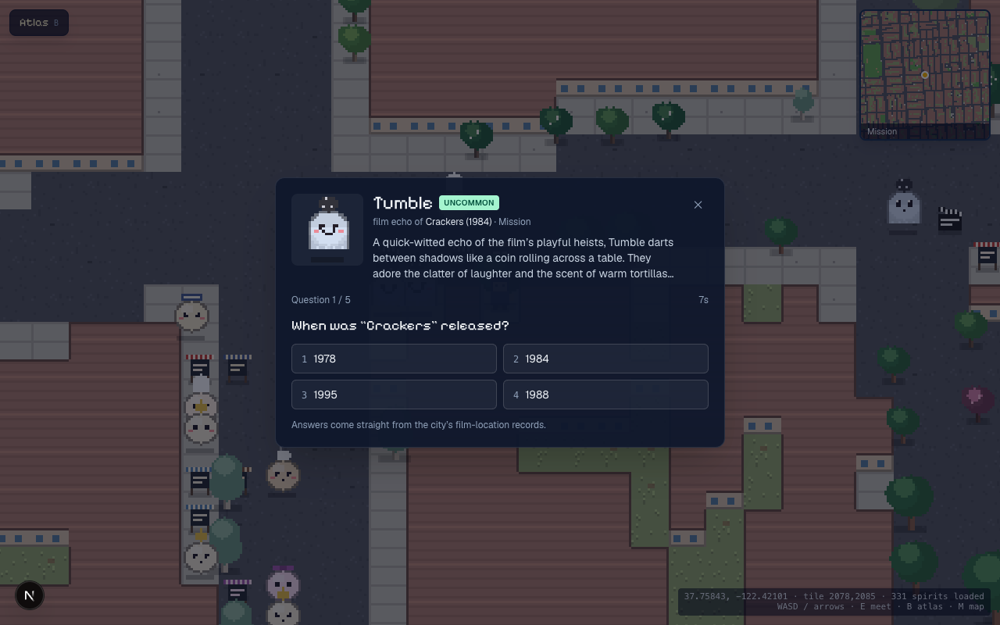
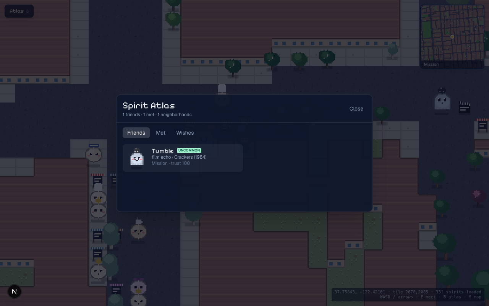

# SF Spirits

[](https://github.com/rudrakshchaudhry/Spirits/actions/workflows/ci.yml)

An open-world pixel game on the real map of San Francisco. Spirits live at real places from SF open data:
street trees, local shops, film locations, public art, landmarks and parks. You walk the city, find them, play a
short game written from the real record, and befriend them.

<p>
  
  
</p>

## Contents
- [What's in the game](#whats-in-the-game)
- [How it works](#how-it-works)
- [Quick start](#quick-start)
- [Setting up on a new machine](#setting-up-on-a-new-machine)
- [Scripts](#scripts)
- [Project layout](#project-layout)
- [Testing and CI](#testing-and-ci)
- [Deploying](#deploying)
- [Privacy and data accuracy](#privacy-and-data-accuracy)

## What's in the game
- **The city:** OpenStreetMap terrain baked into 2,098 chunks of 4 m tiles; 41 neighbourhoods with title cards.
- **Spirits:** deterministic daily spawns from ~147k Elasticsearch places, in six families with procedural sprites.
  Night, fog, rain and blossom variants appear only while that condition is live (Open-Meteo + `suncalc`).
- **Encounters:** each spirit has a Mistral Large card (JSON mode, moderated, cached in Elasticsearch), a streamed
  Mistral Small greeting, and one game per family. Trust is scored on the server.
  | Family | Game |
  |---|---|
  | Trees, parks | Rustle / Birdsong (rhythm) |
  | Shops | Rush Hour (remember the order) |
  | Landmarks | Then or Now (which real nearby place?) |
  | Films | Take Two (trivia from the film record) |
  | Public art | Mosaic (rotate the tiles) |
- **Keepsakes and wishes:** glints appear every 2 hours, typed by the places nearby, plus keepsakes that are tied to
  a condition or exclusive to a neighbourhood. The right gift grants a spirit's wish: +40 trust, a rare friendship
  and a secret chapter. A hybrid BM25 + kNN (RRF) search links each wish to a place across town. Revisiting a
  friend after a day unlocks the next lore chapter, and sometimes brings a new wish.
- **Living world:** day/night, fog and rain; a 311 "haze" veil per neighbourhood (aggregates only); a sparkle on
  new shops; a daily featured rare spirit.
- **Together:**
  - onboarding (handle, home crew, companion), a companion that evolves, and milestone unlocks;
  - keepsake trading and public profiles;
  - a **weekly crew board**: new ground ×1 + friends ×5 + wishes ×10 (first and revisit wishes), divided by the
    crew's active members;
  - **gatherings** at public parks: a GPS check-in that stores only yes/no, a Realtime lobby and a co-op game.

**Controls:**
- WASD or arrows to move (Shift to jog); **E**, Space or click to meet a spirit.
- **B** opens the Spirit Atlas, **T** the Town panel, **M** the city map.
- On phones, drag in the lower-left corner for the joystick, then tap "Meet".

**URL flags:** `?dev=1` (coordinates, dev conditions panel, click-to-teleport), `?at=lat,lon`, `?noclip=1`.

<p>
  
  
  
</p>

## How it works
```
Browser (Next.js 16 + React 19 UI, Phaser 3 world)
   │  /api/*  (route handlers; the server is the only authority on trust, keepsakes, scores)
   ▼
Next.js server ──► Elasticsearch 9 (places, spirit cards, neighbourhoods, gatherings; geo + hybrid search)
               ──► Supabase Postgres (player state; RLS read-own; atomic plpgsql functions for every write race)
               ──► Mistral (cards, greetings, embeddings, moderation)
               ──► Open-Meteo (weather)            Cron (Vercel or the Docker sidecar): 311 haze, new shops, featured
Data ingest (scripts/ingest): DataSF → Elasticsearch
```
- **Deterministic world:** spawns are `hash(place | date | condition)`, and glints are per chunk per 2-hour window.
  Every client sees the same city without the server storing it.
- **Server authority:** encounter tokens are HMAC-signed and single-use. Gifts, pickups, trades, plays and gathering
  results go through row-locked Postgres functions, so double clicks and replays can't duplicate anything.
- **Caching:** `'use cache'` with `cacheLife` for conditions, world chunks, featured and the crew board. World
  chunks are tagged by date, and the crew board is tagged and refreshed when a friend or wish is recorded.
  The CDN caches `/api/world` only when the URL names the exact window, date and condition served.

## Quick start
```bash
nvm use                      # Node 22 (.nvmrc); any Node >= 20.9 works
cp .env.example .env.local   # fill in the keys: see the table below
npm ci
npm run dev                  # http://localhost:3000
```
Or with Docker, without a local Node install: `npm run docker:up` builds the production image and serves it on
:3000 with a cron sidecar (see [docs/DEPLOY.md §7](docs/DEPLOY.md#7-option-b-docker--self-hosting)).

## Setting up on a new machine
The game uses three hosted services. Only the Next.js app runs locally.
| Service | Holds | First-time setup |
|---|---|---|
| **Elasticsearch** (Elastic Cloud 9.x) | places, spirit cards, neighbourhoods, gatherings | `npm run es:setup && npm run ingest`, then the scripts in [DEPLOY §5](docs/DEPLOY.md#5-data-one-time-from-your-machine) |
| **Supabase** | player state (friendships, keepsakes, trades, crews) | apply `supabase/migrations/*.sql` in filename order ([DEPLOY §4](docs/DEPLOY.md#4-supabase-settings)) |
| **Mistral** | cards, greetings, embeddings, moderation | API key only |

- **Reusing the existing projects:** copy `.env.local` securely from the old machine. It is git-ignored and must
  never be committed. Every variable is documented in [.env.example](.env.example).
- **Terrain:** the baked map (`public/chunks`, `public/minimap.png`) is committed. Run
  `npm run fetch:terrain && npm run bake` only to rebuild it.
- **Fresh clones:** they build without any env vars, and that is what CI checks. The game itself needs the keys.

## Scripts
| Command | What it does |
|---|---|
| `npm run dev` / `build` / `start` | Next.js dev server / production build / production server |
| `npm run check` | lint + typecheck (`next typegen` + `tsc`) + unit tests |
| `npm test` | unit tests (vitest) |
| `npm run docker:up` / `docker:down` | app + cron sidecar in Docker (reads `.env.local`) |
| `npm run docker:tools -- <cmd>` | run any data script inside the tools image |
| `npm run fetch:terrain && npm run bake` | rebuild the terrain from OSM + DataSF |
| `npm run es:setup` | create or update the Elasticsearch indices (idempotent) |
| `npm run ingest` | DataSF → Elasticsearch, including the 311 haze (~2 min) |
| `npx tsx scripts/embed-places.ts` | `mistral-embed` vectors for the hybrid wish search |
| `npx tsx scripts/seed-gatherings.ts 3` | gatherings at public parks (`--now` adds a live test one) |
| `npx tsx scripts/curate-quest.ts` | the Tenderloin → Ocean Beach sea-shell quest |
| `npx tsx scripts/prewarm.ts 10` | pre-generate spirit cards along the demo route |
| `npx tsx scripts/check-demo-queries.ts` | run `elastic/demo-queries.console` |
| `npx tsx scripts/e2e-quest.ts <placeId>` | API end-to-end: meet → play → pickup → gift |
| `npx tsx scripts/e2e-social.ts` | API end-to-end: onboarding, trades, crews, gatherings |

The e2e scripts target `E2E_BASE` (default `http://localhost:3000`) and create guest accounts.

## Project layout
```
app/            Next.js app router: the page and all /api route handlers (encounter, world, social, cron…)
components/     React UI: encounter dialog, Atlas, HUD, Town (social) panels
game/           Phaser scene, procedural art, atmosphere (fog, rain, night)
lib/            server and shared logic
  conditions/   weather, sun phase, condition keys      keepsakes/  catalog, glints, gift server logic
  encounter/    mini-game content, signed tokens         social/     crews, trades, gatherings, presence, limits
  spirits/      spawning, Mistral cards, revisit wishes  world/      chunks, entities, featured, haze
  es/ mistral/ supabase/ geo/ places/                   clients, mappings, projection, place catalog
scripts/        terrain bake, DataSF ingest, data setup, e2e checks
supabase/       SQL migrations (apply in order)
elastic/        Kibana Dev Tools demo queries
public/         baked terrain chunks, minimap, neighbourhood outlines
docs/           DEPLOY, DEMO, pitch checklist, screenshots
.plans/         product spec and the progress tracker
Dockerfile, docker-compose.yml, docker/   container build and the cron sidecar
```

## Testing and CI
- `npm run check` runs lint, typecheck and the 33 unit tests: projection, spawning, glints, conditions and weather
  parsing, tokens, games, catalog, social rules, trades, check-in distance, DST week boundaries.
- The e2e scripts above exercise the full API against a running server.
- [CI](.github/workflows/ci.yml) runs on every PR and every push to `main`: lint, typecheck, tests, `next build` and a
  Docker image build. No secrets are needed.

## Deploying
[docs/DEPLOY.md](docs/DEPLOY.md) covers both options:
- **Vercel** (recommended): env vars, cron plan limits and Supabase settings.
- **Docker / self-hosting**: the standalone image and the cron sidecar.

Demo script: [docs/DEMO.md](docs/DEMO.md). Pitch: [PITCH_NOTES.md](PITCH_NOTES.md).

## Privacy and data accuracy
- **Player location is never stored.** Exploration is reported as chunk keys (256 m squares). A gathering check-in
  sends GPS once; the server checks the distance and keeps only a yes/no.
- **The 311 haze uses neighbourhood aggregates only;** individual cases are never stored or shown.
- **Facts in games come from dataset fields or Elasticsearch results,** never from model memory. Shop games use
  generic menus, not claims about a real business.
- **Text is moderated:** model output (cards, riddles) and player handles go through Mistral moderation.
- **Accounts:** guest accounts are rate-limited per salted IP hash.
